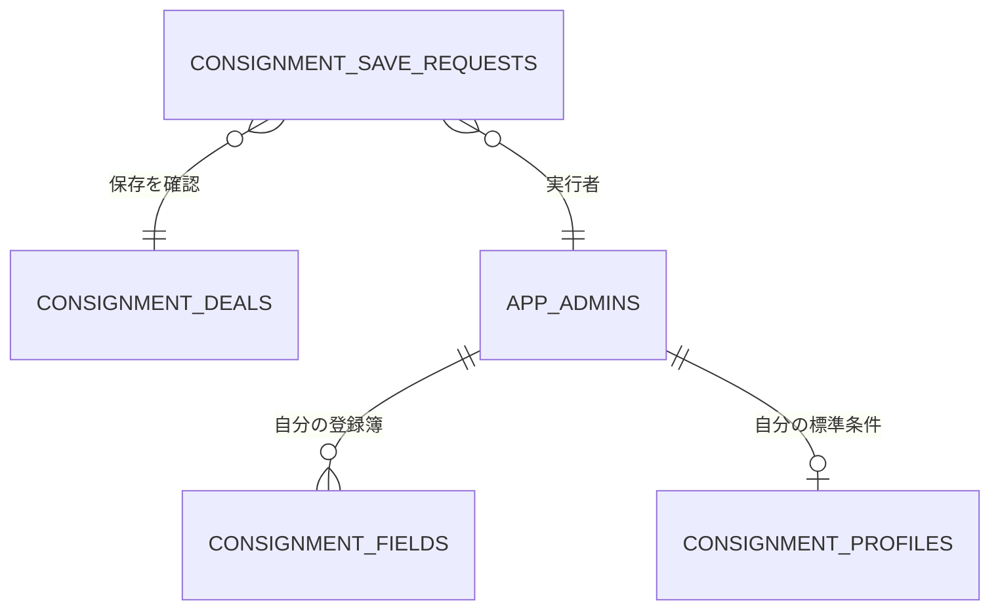

# 委託案件の保存（A11後半）

案件本体、圃場登録簿、初回標準取引条件を `save_my_consignment_bundle` の一回で確定する。どの書込が失敗しても、保存操作の台帳を含めて全取消する。以前の「案件成功後に登録簿を非同期保存」「掲載後に標準条件を別保存」は廃止。

| 役割 | GitHub内の正本 |
| --- | --- |
| 入力の型と表示 | `src/features/consignment/model.js` |
| 入力と保存操作の管理 | `src/features/consignment/consignmentRecord.js` |
| 画面・復元 | `src/features/consignment/ConsignmentRoom.jsx` |
| 確定・競合比較・再送 | `supabase/migrations/20261018145244_consignment_deal_atomic_save.sql` |

`private.consignment_save_requests` は操作UUID、利用者UUID、案件UUID、比較元と送信内容、確定時の結果を保存する。RLS有効、匿名・認証済利用者の直接参照/更新を禁止。公開関数はinvoker、内部関数は固定search_pathのdefiner。サーバーで `auth.uid() = p_owner` と既存の `app_admins` 所属を確認する。管理者限定の公開範囲は変更しない。

図は保存処理で照合する論理関係。新規FKは設けず、既存案件を移行・再掲載しない。

端末は送信前に利用者・案件別の操作を保持する。保存領域へ書けない場合は送信を始めない。応答が不明なら同じ操作ID・送信内容で確認する。後で入力が変わっていた場合、前回分だけを確認し、変更後の内容を保存済みと表示しない。再読込時にも元の比較値を復元する。

案件は仕様書・状態・メモ・更新日時をロック中に比較し、古い入力を拒否する。圃場は既存の正式住所・設備JSONを保持し、面積が比較元から変わった場合は拒否する。標準条件は許可した4項目だけ、空欄へ補完する。別の値がすでに入った場合は全保存を拒否し、黙って入力を捨てない。

試験は本番から取得した列定義・トリガー（利用者データなし）を使う実SQL、保存管理コード、実React画面で実施。SQL試験は各書込失敗時の全取消、通常保存、再送、後続編集後の古い応答再取得、古い比較元、権限拒否を扱う。画面試験は失敗時入力保持・二重クリック・再読込復元を扱う。PGliteは単一接続なので、実際の2端末同時接続負荷試験とは異なる。

## 残る別経路

状態進行・日次進捗、貸与品登録、圃場単独編集、旧写真の自動軽量化は別の保存経路。今回の原子保存の完了を、それらの完了と扱わない。旧クライアントは再読込が必要。入力中の通常下書きの常時保存は今回追加していない（未確定の送信操作のみ保持）。
